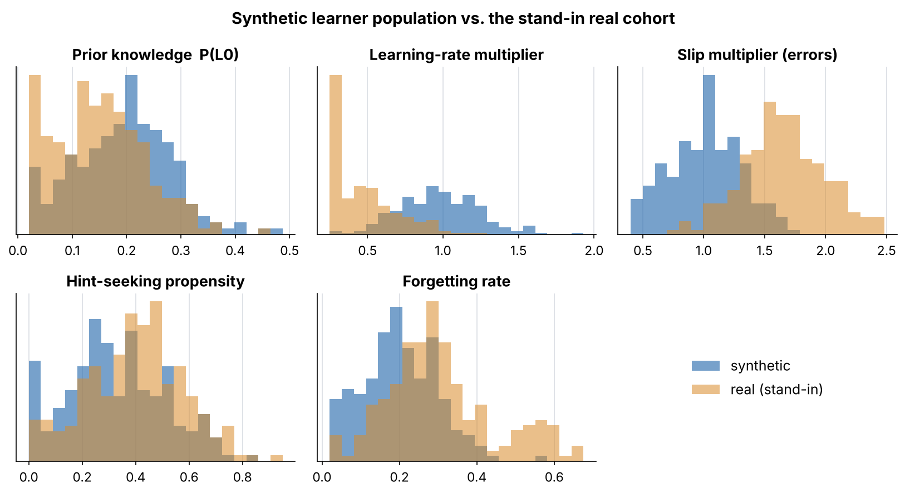
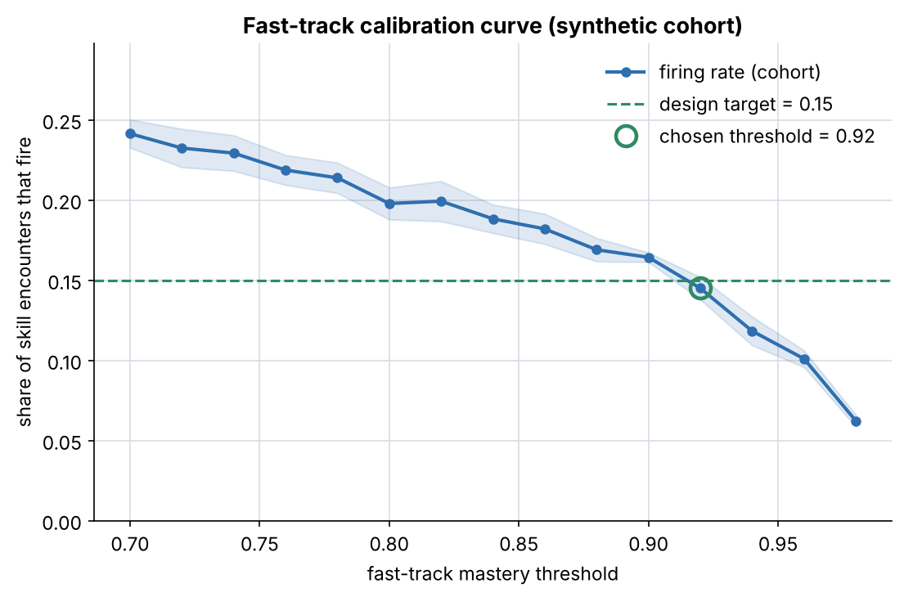
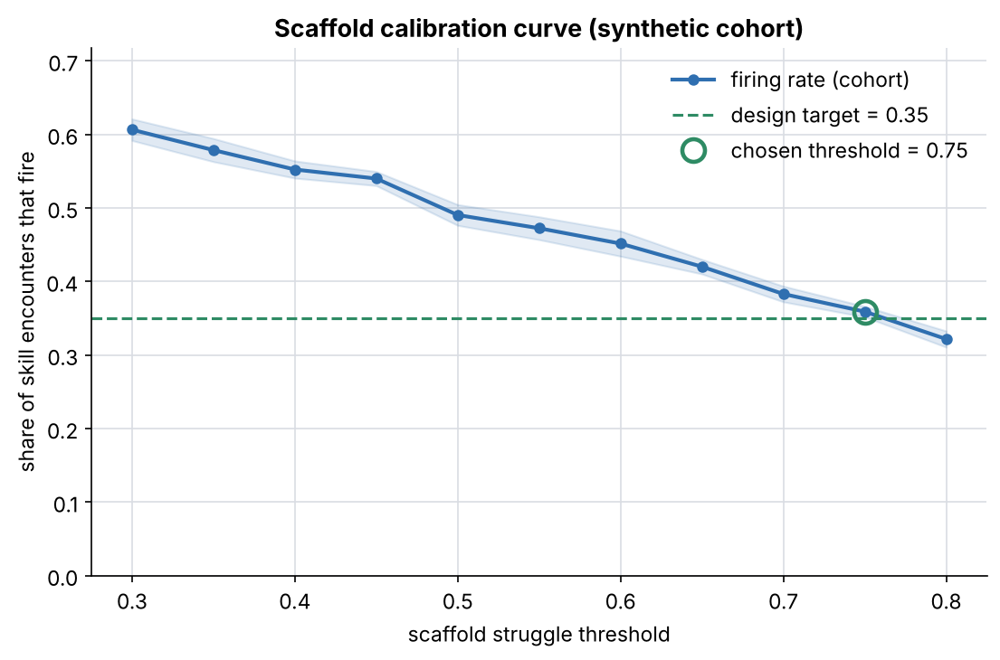
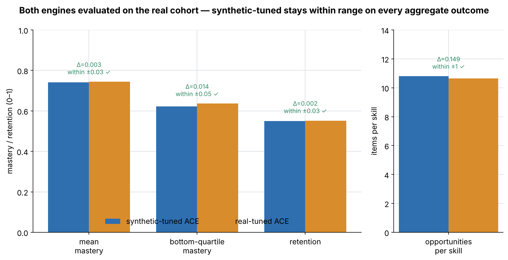
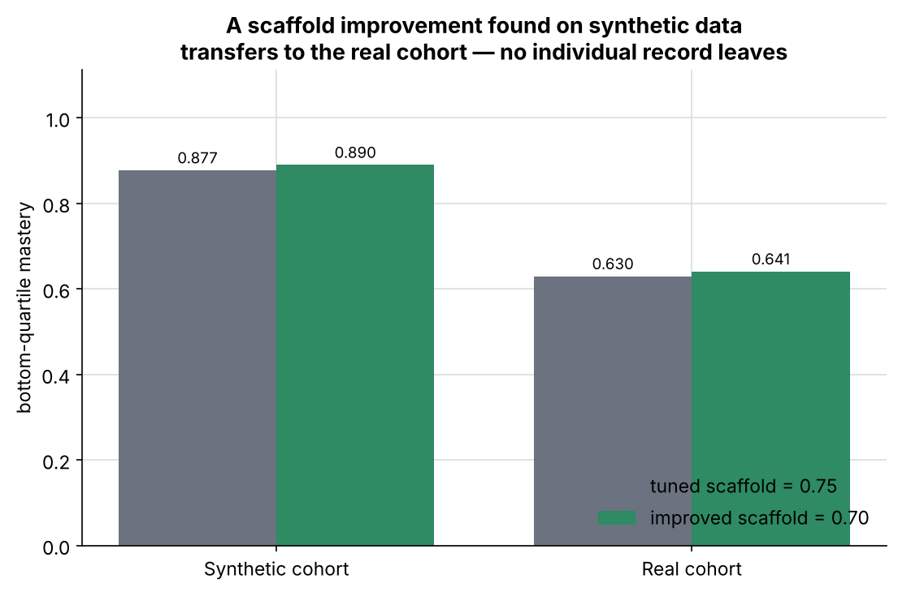
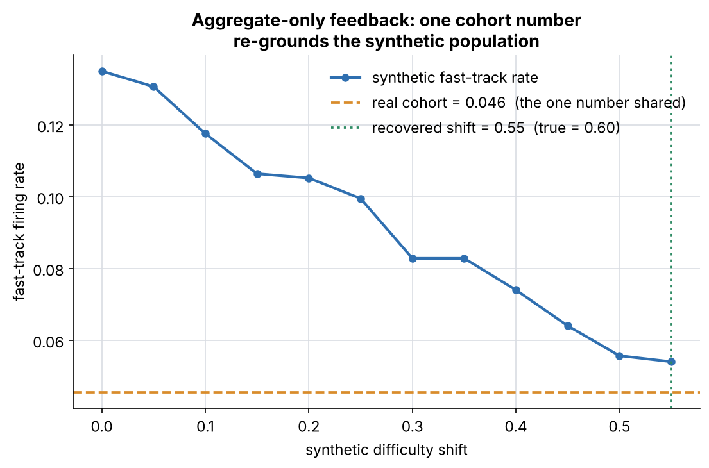
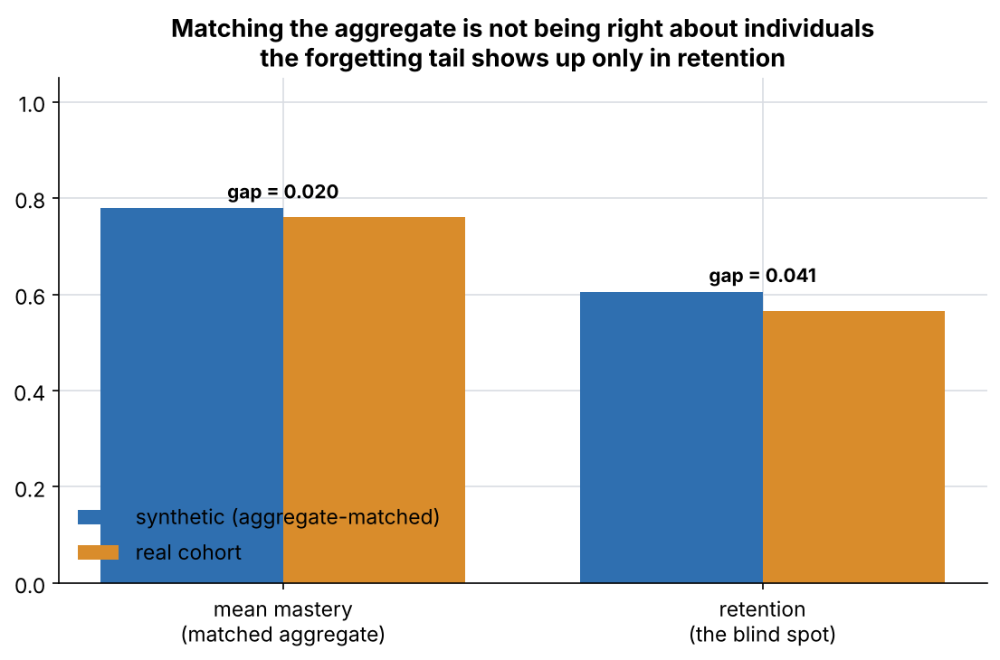

# Prototype 3 — Synthetic Student Tuning

> From **"Wicked Problem Prototypes: Personalization Without the Data Districts
> Can't Defend"** (Linda Bernard, Nov 2026).

**ACE is developed and calibrated on simulated middle schoolers, so real
student data is needed only for validation at low volume, and never for model
development.** This is the prototype that answers the obvious objection to the
two-stream model: *if QuestSim never gets student data, how does the product
get better?*

This is a small, runnable simulation harness — the "notebook is enough"
fidelity the write-up calls for, built out as a clean Python package so each
claim is reproducible.

---

## What it does

1. **Generates ~200 synthetic learners** as agents, each with five parameters
   grounded in learning-science literature (not invented):
   prior knowledge, learning rate, slip/error tendency, hint-seeking, and
   mastery decay.
2. **Runs them through a Pythagoras Quest skill sequence** (a 7-skill
   Pythagorean-theorem unit) under ACE, which tracks per-skill mastery with
   Bayesian Knowledge Tracing and fires two interventions — **scaffold** (help
   a struggler) and **fast-track** (advance a quick master).
3. **Produces calibration curves** for ACE's scaffold and fast-track triggers:
   firing rate vs. threshold, averaged over cohort resamples, so a threshold
   can be chosen to hit a pedagogical design target.
4. **Runs the validation test** the write-up specifies — see below.

Crucially, the harness only ever returns **cohort-level aggregates**. Per-student
records are built inside the simulation, used to compute aggregates, and
discarded — mirroring the engineering-stream rule: *the real-world input is
aggregate only, "did the fast-track trigger fire too often across a cohort, not
for whom."*

---

## The test (and its pre-registered criterion)

Per the write-up, the "within range" criterion is set **before** running. The
synthetic-tuned engine, evaluated on the real cohort, must match the real-tuned
engine on every aggregate outcome to within: mean mastery ±0.03, bottom-quartile
mastery ±0.05, retention ±0.03, opportunities/skill ±1.0.

Because no real pilot data is available yet (an open question in the write-up),
a **stand-in "real" cohort** is simulated. To keep the test honest it is
deliberately *mis-specified* relative to the synthetic family: the synthetic
distribution made harder **plus a high-forgetting tail** (absenteeism / summer
slide) the synthetic priors cannot express.

| Step | What it shows |
|---|---|
| **Within range** | Tune ACE on synthetic data and on real data; evaluate both on the real cohort. The synthetic-tuned engine lands within range on every aggregate outcome — **built with zero student data**. |
| **Transfer** | An improvement found on synthetic data (a better scaffold threshold, chosen to lift strugglers within an intervention budget) also lifts the real cohort — **no individual record leaves the district**. |
| **Aggregate-only feedback** | One number — the real cohort's fast-track firing rate — is fed back and re-grounds the synthetic population's difficulty, recovering the real shift. No records read. |
| **Caveat** | After matching the aggregate, the synthetic model still mis-predicts **retention**, because the real cohort's forgetting tail is outside its family. Aggregate match ≠ right about individuals — which is why the two streams validate each other. |

Latest run (`output/REPORT.md` has the live numbers):

- Within range: **PASS** on all four aggregate outcomes.
- Transfer: scaffold improvement found on synthetic data lifts the real
  cohort's bottom-quartile mastery — transfers ✔.
- Feedback: the real fast-track rate alone recovers the real cohort's
  difficulty shift (~0.55 vs. a true 0.60).
- Caveat: the retention gap (~0.04) is about twice the matched mastery gap.

---

## Run it

```bash
pip install -r requirements.txt
python run.py
```

This regenerates `figures/` (seven PNGs), `output/REPORT.md`,
`output/report.html` (a self-contained visual summary), `output/aggregates.json`,
and `output/calibration.csv`. The run is deterministic (fixed seeds) and takes
about 10 seconds.

A narrative walkthrough is in
[`notebook/Prototype3_Synthetic_Student_Tuning.ipynb`](notebook/Prototype3_Synthetic_Student_Tuning.ipynb).

---

## Figures

| | |
|---|---|
|  |  |
|  |  |
|  |  |



---

## Layout

```
.
├── README.md
├── requirements.txt
├── run.py                       # end-to-end: calibrate + test + figures + report
├── synthetic_tuning/
│   ├── skills.py                # Pythagoras Quest skills + simulation constants
│   ├── learners.py              # synthetic learner agents (5 grounded parameters)
│   ├── ace.py                   # ACE: BKT mastery + scaffold / fast-track triggers
│   ├── harness.py               # run a cohort (aggregates only), calibrate
│   ├── validation.py            # within-range test, transfer, feedback, caveat
│   └── plotting.py              # figures (matplotlib, lazily imported)
├── notebook/
│   └── Prototype3_Synthetic_Student_Tuning.ipynb
├── figures/                     # generated PNGs (committed)
└── output/                      # generated REPORT.md, report.html, json, csv
```

---

## How the parameters are grounded

The write-up warns: the parameters "have to be grounded in something … rather
than invented." Each learner parameter maps to a published model:

- **prior, learn, slip, guess, 0.95 mastery threshold** — Bayesian Knowledge
  Tracing: Corbett & Anderson (1995), *Knowledge tracing: modeling the
  acquisition of procedural knowledge*.
- **learning rate** — the power law of practice: Newell & Rosenbloom (1981).
- **hint-seeking** — help-seeking / help-avoidance: Aleven, McLaren, Roll &
  Koedinger (2006).
- **mastery decay** — the forgetting curve: Ebbinghaus (1885), as formalised by
  Pavlik & Anderson (2005), *Practice and forgetting effects … an ACT-R model*.

## What this is not

A synthetic population tuned to match real aggregates can still be wrong about
individuals in ways that only show up in real classrooms — demonstrated here by
the retention blind spot. The two streams validate each other; neither replaces
the other. These are illustrative learning-science parameters, not QuestSim's
actual ACE signal set, which would come from the engineering team (an open
question in the write-up).
