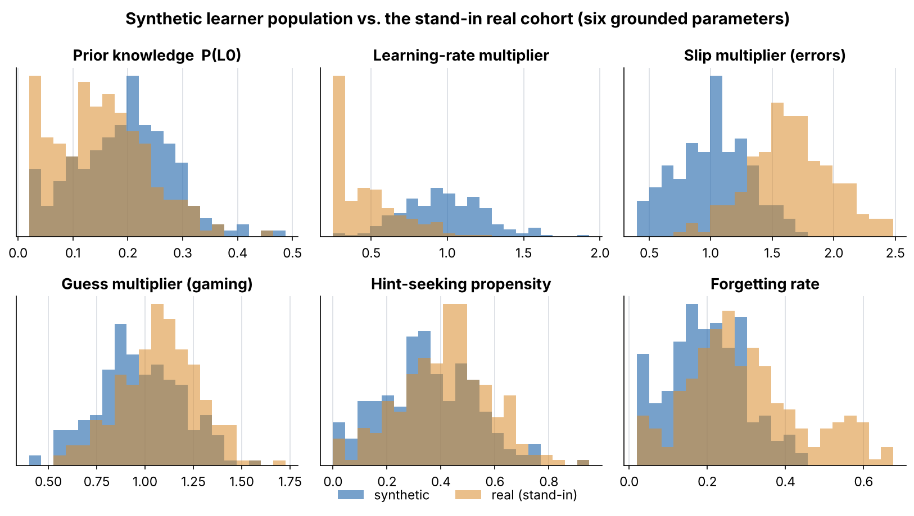
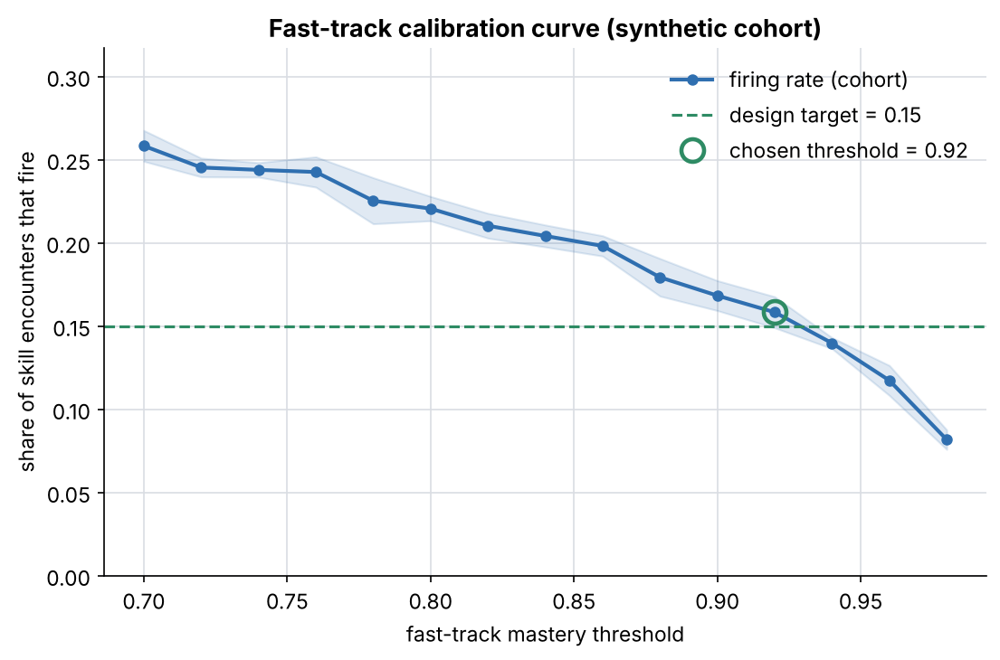
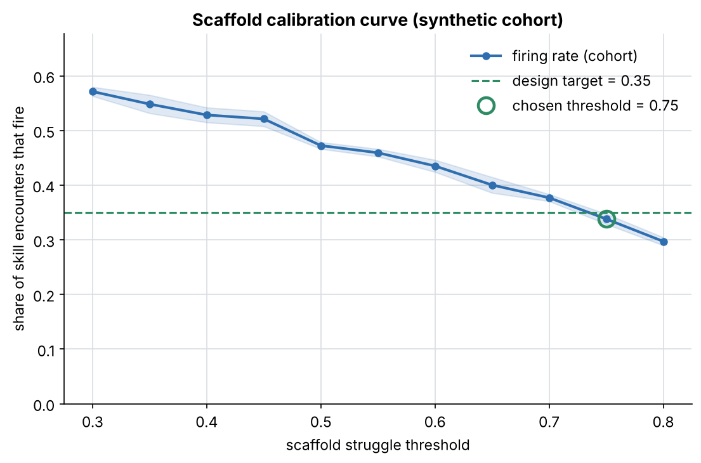
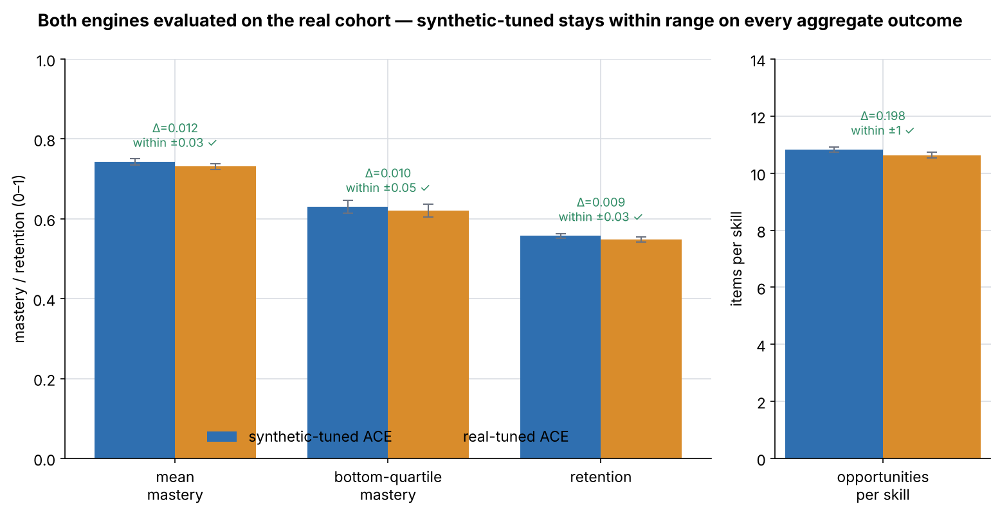
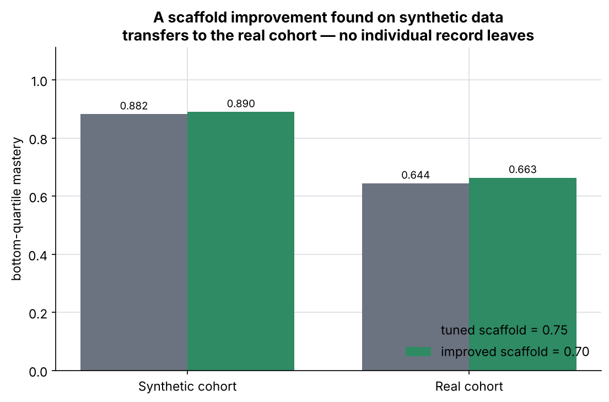
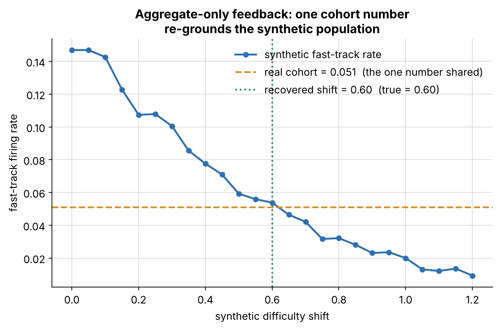
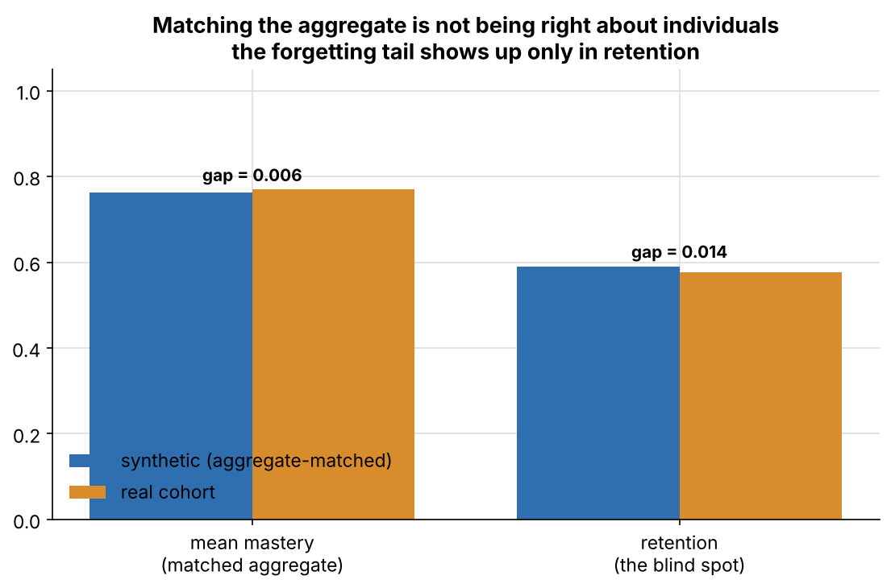
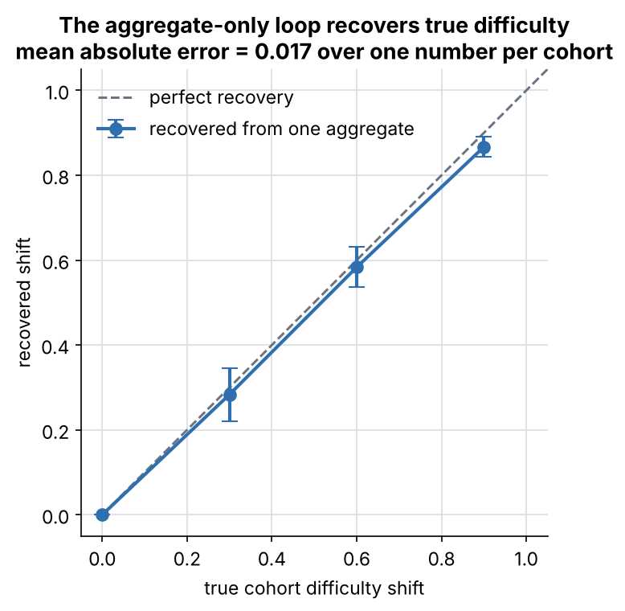
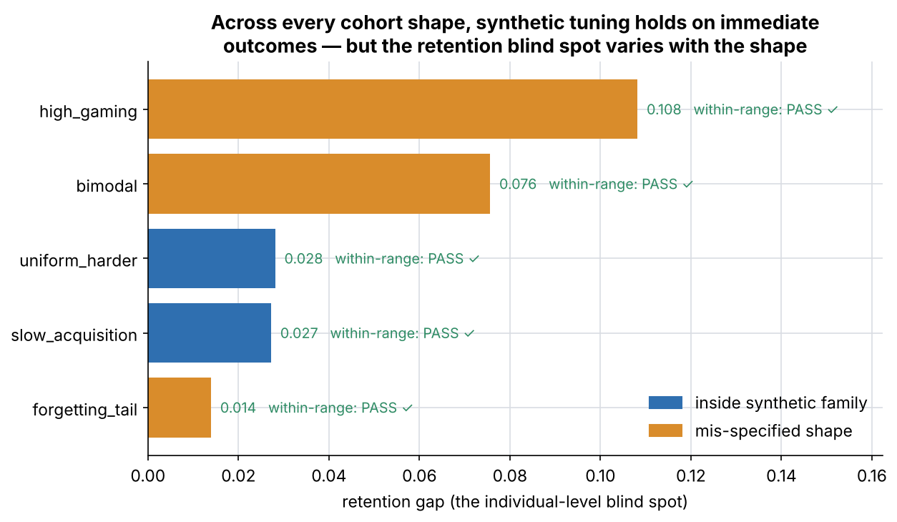
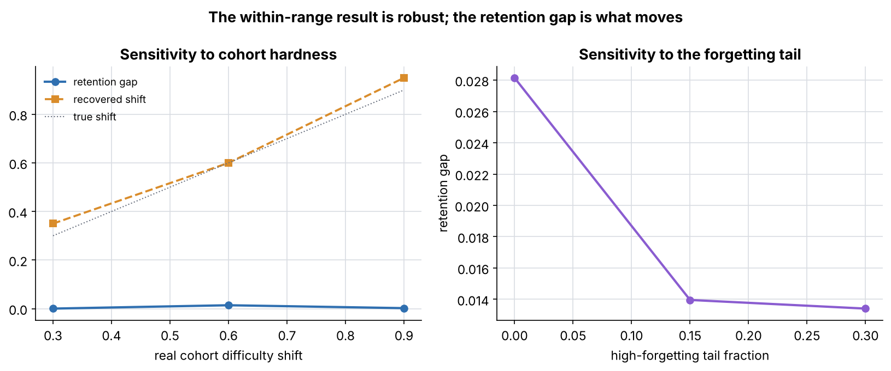

# Prototype 3 — Synthetic Student Tuning

> From **"Wicked Problem Prototypes: Personalization Without the Data Districts
> Can't Defend"** (Linda Bernard, Nov 2026).

**ACE is developed and calibrated on simulated middle schoolers, so real
student data is needed only for validation at low volume, and never for model
development.** This is the prototype that answers the obvious objection to the
two-stream model: *if QuestSim never gets student data, how does the product
get better?*

This is a small, runnable simulation harness — the "notebook is enough"
fidelity the write-up calls for, built out as a clean Python package so each
claim is reproducible.

---

## What it does

1. **Generates ~200 synthetic learners** as agents, each with **six** parameters
   grounded in learning-science literature (not invented): prior knowledge,
   learning rate, slip/error tendency, guessing/gaming, hint-seeking, and
   mastery decay. The skill sequence is **cumulative** — a mastered prerequisite
   raises the effective prior on the next skill.
2. **Runs them through a Pythagoras Quest skill sequence** (a 7-skill
   Pythagorean-theorem unit) under ACE, which tracks per-skill mastery with
   Bayesian Knowledge Tracing and fires two interventions — **scaffold** (help
   a struggler) and **fast-track** (advance a quick master).
3. **Produces calibration curves** for ACE's scaffold and fast-track triggers:
   firing rate vs. threshold, averaged over cohort resamples, so a threshold
   can be chosen to hit a pedagogical design target.
4. **Runs the validation test** the write-up specifies — see below.

Crucially, the harness only ever returns **cohort-level aggregates**. Per-student
records are built inside the simulation, used to compute aggregates, and
discarded — mirroring the engineering-stream rule: *the real-world input is
aggregate only, "did the fast-track trigger fire too often across a cohort, not
for whom."*

---

## The test (and its pre-registered criterion)

Per the write-up, the "within range" criterion is set **before** running. The
synthetic-tuned engine, evaluated on the real cohort, must match the real-tuned
engine on every aggregate outcome to within: mean mastery ±0.03, bottom-quartile
mastery ±0.05, retention ±0.03, opportunities/skill ±1.0.

Because no real pilot data is available yet (an open question in the write-up),
a **stand-in "real" cohort** is simulated. To keep the test honest it is
deliberately *mis-specified* relative to the synthetic family: the synthetic
distribution made harder **plus a high-forgetting tail** (absenteeism / summer
slide) the synthetic priors cannot express.

| Step | What it shows |
|---|---|
| **Within range** | Tune ACE on synthetic data and on real data; evaluate both on the real cohort. The synthetic-tuned engine lands within range on every aggregate outcome — **built with zero student data**. |
| **Transfer** | An improvement found on synthetic data (a better scaffold threshold, chosen to lift strugglers within an intervention budget) also lifts the real cohort — **no individual record leaves the district**. |
| **Aggregate-only feedback** | One number — the real cohort's fast-track firing rate — is fed back and re-grounds the synthetic population's difficulty, recovering the real shift. No records read. |
| **Caveat** | After matching the aggregate, the synthetic model still mis-predicts **retention**, because the real cohort's forgetting tail is outside its family. Aggregate match ≠ right about individuals — which is why the two streams validate each other. |

Latest run (`output/REPORT.md` has the live numbers):

- Within range: **PASS** on all four aggregate outcomes (evaluated over 12
  resamples, so each delta carries a confidence band).
- Transfer: scaffold improvement found on synthetic data lifts the real
  cohort's bottom-quartile mastery — transfers ✔.
- Feedback: the real fast-track rate alone recovers the real cohort's
  difficulty shift (**0.60 vs. a true 0.60**).
- Caveat: the retention gap is larger than the matched mastery gap.

---

## Build-out: rigor, scenarios, and a live-data hook

Beyond the core demonstration, the harness carries the analyses a class
presentation needs to defend it:

- **Parameter recovery** (`analysis.parameter_recovery`) — build cohorts at a
  range of *known* difficulties, feed one aggregate number back each time, and
  measure how well the loop recovers the truth. Latest **mean absolute error ≈
  0.017**: the aggregate-only loop is identifying real difficulty, not noise.
- **Scenario sweep** (`scenarios.py`, `validation.run_scenarios`) — the whole
  test re-run against **five** stand-in real cohorts: a uniform harder cohort, a
  forgetting tail, a bimodal split, a high-gaming cohort, and a slow-acquisition
  cohort. Synthetic tuning holds on the immediate outcomes for every shape; the
  **retention blind spot varies** and is largest for the mis-specified shapes.
- **Sensitivity** (`analysis.sensitivity`) — one-at-a-time sweeps of the
  (unknown) real-cohort assumptions. The within-range result is robust; what
  moves is the retention gap, which a real pilot would pin down.
- **Bootstrap CIs** (`analysis.bootstrap_ci`) — 95% intervals on the recovered
  shift and the retention gap over many resamples.
- **Test suite** (`tests/`) — `python -m pytest -q` runs 16 tests covering
  determinism, the BKT model, the **aggregates-only invariant** (no per-student
  array ever leaves `run_cohort`), calibration monotonicity, the within-range
  pass, recovery accuracy, and the live-data guardrails.

### Live-data hook

The aggregate-only feedback loop can read a real cohort's **one number** from a
district file (`synthetic_tuning/real_data.py`). It enforces the write-up's
minimum-cohort guardrail and **refuses any file carrying a per-student field**,
so only an aggregate is ever consumed. Worked examples are in `examples/`:

```bash
python run.py --real-aggregate examples/real_aggregate.json
```

```json
{ "label": "Maple Grove USD — spring pilot", "cohort_size": 180, "fast_track_rate": 0.047 }
```

---

## Run it

```bash
cd prototype-3-synthetic-student-tuning
pip install -r requirements.txt
python run.py                         # everything (~2 min)
python run.py --quick                 # core only, skip the rigor layer (~15s)
python run.py --real-aggregate examples/real_aggregate.json   # + live-data hook
python -m pytest -q                   # the test suite (16 tests)
```

A full run regenerates `figures/` (ten PNGs), `output/REPORT.md`,
`output/report.html` (a self-contained visual summary), `output/FINDINGS.md`
(a slide-style summary), `output/aggregates.json`, and `output/calibration.csv`.
The run is deterministic (fixed seeds).

A narrative walkthrough is in
[`notebook/Prototype3_Synthetic_Student_Tuning.ipynb`](notebook/Prototype3_Synthetic_Student_Tuning.ipynb).

---

## Figures

| | |
|---|---|
|  |  |
|  |  |
|  |  |



The build-out adds three more:

| | |
|---|---|
|  |  |



---

## Layout

```
.
├── README.md
├── requirements.txt
├── run.py                       # end-to-end: calibrate + test + rigor + figures + report
├── synthetic_tuning/
│   ├── skills.py                # Pythagoras Quest skills + simulation constants
│   ├── learners.py              # synthetic learner agents (6 grounded parameters)
│   ├── ace.py                   # ACE: BKT mastery + scaffold / fast-track triggers
│   ├── harness.py               # run a cohort (aggregates only), calibrate
│   ├── validation.py            # within-range test, transfer, feedback, caveat, scenarios
│   ├── scenarios.py             # library of stand-in real-cohort shapes
│   ├── analysis.py              # parameter recovery, sensitivity, bootstrap CIs
│   ├── real_data.py             # live-data hook: aggregate-only, guardrailed
│   └── plotting.py              # figures (matplotlib, lazily imported)
├── tests/test_harness.py        # pytest suite (16 tests)
├── examples/                    # worked district aggregate files (.json / .csv)
├── notebook/
│   └── Prototype3_Synthetic_Student_Tuning.ipynb
├── figures/                     # generated PNGs (committed)
└── output/                      # REPORT.md, report.html, FINDINGS.md, json, csv
```

---

## How the parameters are grounded

The write-up warns: the parameters "have to be grounded in something … rather
than invented." Each learner parameter maps to a published model:

- **prior, slip, 0.95 mastery threshold** — Bayesian Knowledge Tracing: Corbett
  & Anderson (1995), *Knowledge tracing: modeling the acquisition of procedural
  knowledge*.
- **learning rate** — the power law of practice: Newell & Rosenbloom (1981).
- **guessing / gaming** — Baker, Corbett, Roll & Koedinger (2008), *Developing a
  generalizable detector of when students game the system*.
- **hint-seeking** — help-seeking / help-avoidance: Aleven, McLaren, Roll &
  Koedinger (2006).
- **mastery decay** — the forgetting curve: Ebbinghaus (1885), as formalised by
  Pavlik & Anderson (2005), *Practice and forgetting effects … an ACT-R model*.
- **cumulative prerequisites** — later skills build on earlier ones, so a
  mastered prerequisite raises the next skill's effective prior.

## What this is not

A synthetic population tuned to match real aggregates can still be wrong about
individuals in ways that only show up in real classrooms — demonstrated here by
the retention blind spot. The two streams validate each other; neither replaces
the other. These are illustrative learning-science parameters, not QuestSim's
actual ACE signal set, which would come from the engineering team (an open
question in the write-up).
